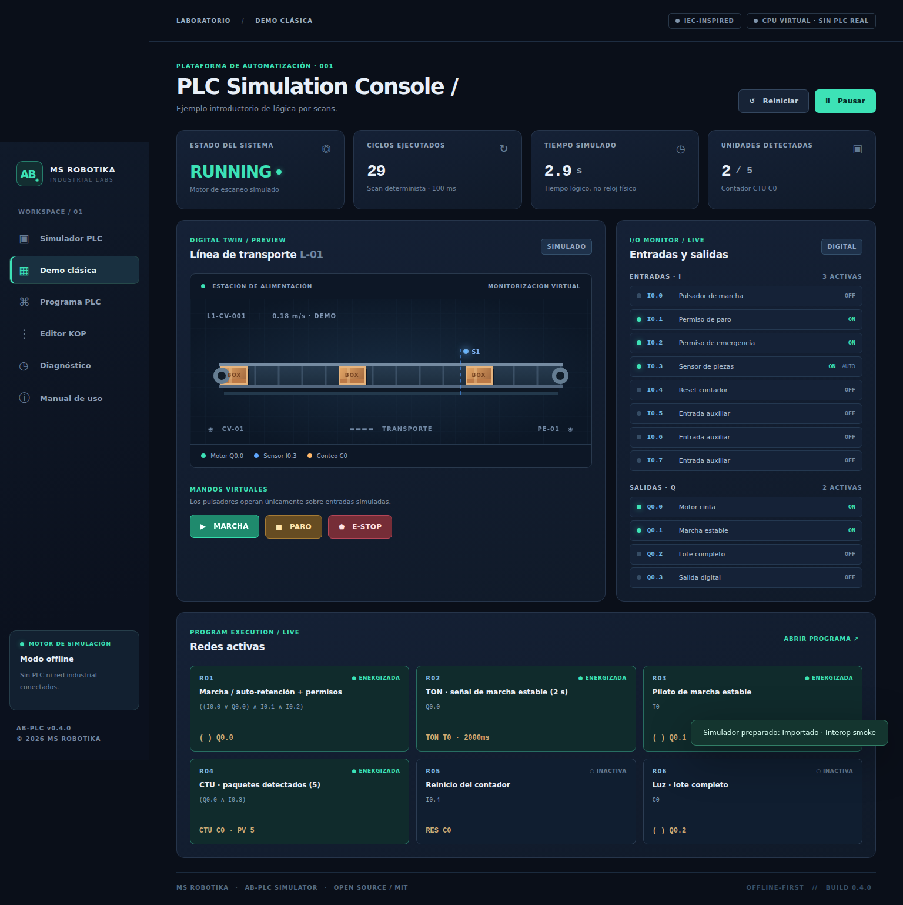
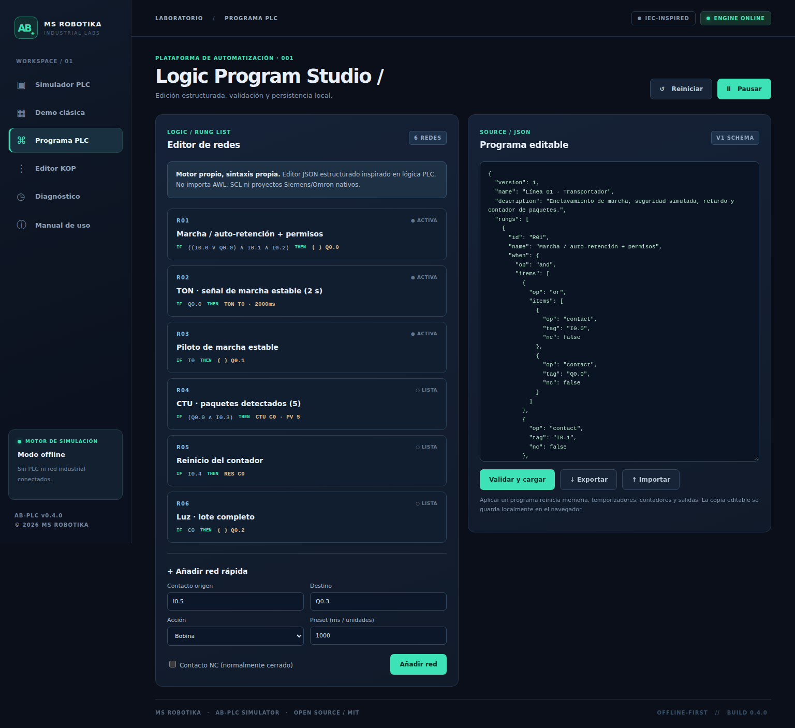

# AB-PLC Simulator

**MS ROBOTIKA · Industrial Labs · v0.1.0**

**Simulador PLC propio, gratuito y abierto**: ejecuta lógica por ciclos, ofrece monitorización de variables, cinta transportadora virtual, editor JSON, diagnóstico y pruebas.

[Demo web (cuando GitHub Pages esté habilitado)](https://msrobotika.github.io/AB-PLC-Simulator/)

## Capturas de la aplicación real

La acción [Capture screenshots](.github/workflows/screenshots.yml) genera capturas auténticas del navegador y las versiona en docs/screenshots. Si la primera acción todavía no ha terminado, las imágenes aún no estarán disponibles.

## Funciones implementadas

| Función | Estado |
|---|---|
| Escaneo determinista, entradas/salidas y marcas | ✅ |
| Contactos NO/NC, AND/OR/NOT | ✅ |
| Coil, SET, RESET, TON, TOF, CTU | ✅ |
| Comparador de entrada analógica | ✅ |
| Consola responsive, cinta y sensores virtuales | ✅ |
| Inspector, registros de eventos, importación/exportación JSON | ✅ |
| Pruebas automáticas / GitHub Actions | ✅ |
| KOP gráfico, AWL, SCL, GRAFCET nativos | **Pendiente** |
| Modbus TCP, OPC UA, conexión con PLC real | **Pendiente** |

No se afirma compatibilidad con formatos Siemens/Omron, ni conformidad IEC 61131-3.

## Ejecutar en Windows, Linux o macOS

Requiere **Node.js >= 20**. No necesitas instalar dependencias:

~~~bash
git clone https://github.com/msrobotika/AB-PLC-Simulator.git
cd AB-PLC-Simulator
npm run dev
~~~

Abre **http://127.0.0.1:4173**. Funciona sin conexión a Internet tras descargarlo.

Para ejecutar las pruebas:

~~~bash
npm test
npm run check
~~~

## Ejemplo de funcionamiento · Línea L-01

- Marcha I0.0 con autoenclavamiento de Q0.0.
- Paro I0.1 y permiso de emergencia I0.2: **simulados, no son seguridad real**.
- Temporizador TON T0 (2000 ms) que activa Q0.1.
- Sensor virtual de paquetes I0.3, contador CTU C0 (5 unidades) y piloto Q0.2.
- Reset de contador I0.4.

Las redes se definen en JSON con una condición y una acción:

~~~json
{
  "version": 1,
  "name": "Ejemplo",
  "rungs": [{
    "id": "R01",
    "name": "Marcha",
    "when": {"op":"contact","tag":"I0.0"},
    "action": {"type":"coil","target":"Q0.0"}
  }]
}
~~~

## Diseño técnico

~~~text
index.html                Interfaz
src/
  app.js                  UI, interacción y cinta virtual
  styles.css              Diseño responsive
  plc-engine.js           Motor determinista aislado de la UI
  demo-program.js         Ejemplo de seis redes
scripts/                  Servidor estático y capturas automatizadas
tests/                    Pruebas de lógica
docs/                     Arquitectura, seguridad, hoja de ruta, capturas
.github/workflows/        Verificación, capturas y Pages
~~~

Más detalles en [Arquitectura](docs/ARCHITECTURE.md), [Hoja de ruta](docs/ROADMAP.md) y [Seguridad](docs/SAFETY.md).

**Aviso:** uso educativo y de simulación. No controla máquinas, no implementa parada de emergencia física ni certifica seguridad funcional.

**Licencia:** [MIT](LICENSE). © 2026 MS ROBOTIKA.
